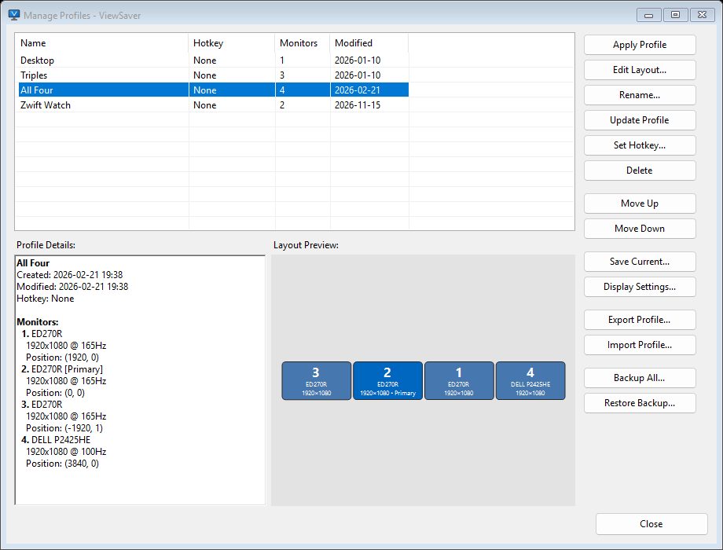
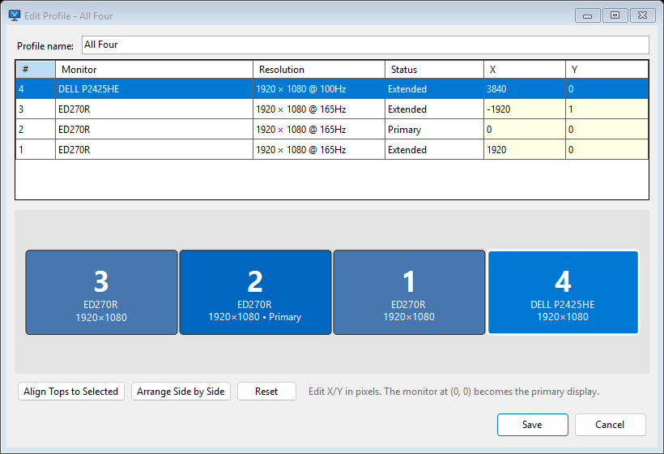

# ViewSaver

**Save and instantly switch between multiple monitor configurations on Windows.**

ViewSaver is a lightweight system tray application that lets you save your current display setup (resolution, refresh rate, monitor arrangement, primary display, enabled/disabled monitors) and restore it with a single click or keyboard shortcut. It's ideal if you often switch between monitor setups, for example docking and undocking a laptop, gaming, or presenting. It's also useful if Windows forgets your layout after sleep or a reconnect.



## Features

- **Save display profiles**: capture resolution, refresh rate, position, orientation, primary display and which monitors are enabled
- **One-click switching**: apply any saved profile from the system tray menu
- **Custom hotkeys**: assign keyboard shortcuts (e.g. Ctrl+Alt+1) for instant switching
- **Layout preview**: see each profile's arrangement, numbered like Windows Settings > Display
- **Edit layouts**: fine-tune monitor positions to the pixel (e.g. line monitor tops up exactly)
- **Export / Import**: share or move individual profiles as `.json` files
- **Backup / Restore**: save all your profiles to one file and restore them later, for example after a reinstall or when Windows loses your layout
- **Runs in the background**: lives in your system tray (hidden icons area)
- **Starts with Windows**: enabled by default so your profiles are always ready

## Requirements

- Windows 10 or Windows 11 (64-bit)
- If you build from source or use a framework-dependent build: the [.NET 10 Desktop Runtime](https://dotnet.microsoft.com/download/dotnet/10.0)

## Installation

1. Download `ViewSaver.exe` from the latest release on the [Releases](../../releases) page. No installer is needed.
2. Put it in a permanent folder, e.g. `C:\Program Files\ViewSaver\` or `%LOCALAPPDATA%\ViewSaver\`
3. Run `ViewSaver.exe`. The ViewSaver icon appears in your system tray. It may be in the hidden-icons area (the **^** arrow next to the clock).

> Windows SmartScreen may show "Windows protected your PC" the first time because the exe isn't code-signed. Click **More info → Run anyway**.

### Run at startup

ViewSaver starts with Windows by default. You can turn this on or off from the tray menu: **Settings... → Start ViewSaver with Windows**.

Alternatively, you can add it to your Startup folder manually:

1. Press <kbd>Win</kbd>+<kbd>R</kbd> (or use the File Explorer address bar), type `shell:startup` and press Enter
2. Paste a shortcut to `ViewSaver.exe` into the folder that opens


## Quick Start

1. **Arrange your monitors**: right-click the tray icon → **Windows Display Settings...**
2. **Save a profile**: right-click the tray icon → **Save Current Configuration...** → enter a name
3. **Apply a profile**: right-click the tray icon → click the profile name
4. **Set a hotkey**: right-click → **Manage Profiles...** → select a profile → **Set Hotkey...**

## Usage

### Saving a profile

1. Configure your displays in Windows Settings > System > Display. The **Display Settings...** button in Manage Profiles and the tray menu opens it for you.
2. Right-click the ViewSaver tray icon and select **Save Current Configuration...**
3. Enter a name for the profile

### Applying a profile

Right-click the ViewSaver icon and click the profile name, press its hotkey, or double-click it in **Manage Profiles**.

If a profile can't be applied, the notification says why (for example, a monitor isn't connected). Full details are written to the log file.

### Managing profiles

Open **Manage Profiles...** from the tray menu (or double-click the tray icon). Select a profile to see its details and a preview of its layout. Drag the dividers between the list, details and preview to resize them.

| Button | What it does |
| --- | --- |
| **Apply Profile** | Switch to the selected profile |
| **Edit Layout...** | Fine-tune the selected profile's monitor positions (see below) |
| **Rename...** | Change the profile's name |
| **Update Profile** | Replace the profile with your current display setup |
| **Set Hotkey...** | Choose modifier keys (Ctrl, Alt, Shift, Win) and a key |
| **Delete** | Remove the profile |
| **Move Up / Move Down** | Change the order in the tray menu |
| **Save Current...** | Save the current setup as a new profile |
| **Display Settings...** | Open Windows Settings > System > Display |

### Editing a layout

**Edit Layout...** shows every monitor in the profile with its X/Y position in pixels and a live preview.



- Type new X/Y values, or click a monitor in the preview to select its row
- **Align Tops to Selected** puts every monitor at the same height as the selected one
- **Arrange Side by Side** lines monitors up left-to-right with no gaps or vertical offsets
- The monitor at (0, 0) is the primary display
- ViewSaver checks the layout with Windows before saving and warns you about overlaps or invalid positions

Resolution and refresh rate can't be edited here. Change them in Windows Display Settings, then use **Update Profile**.

### Export, Import, Backup and Restore

| Button | What it does |
| --- | --- |
| **Export Profile...** | Saves only the selected profile. The file is named after the profile (e.g. `Main Office.json`, or `Main Office (rev 2).json` if that file already exists) |
| **Import Profile...** | Adds profiles from one or more `.json` files to the end of your list. Accepts both exported profiles and backups. Name clashes get a suffix, and hotkeys already in use are cleared |
| **Backup All...** | Saves all profiles to one file (e.g. `ViewSaver Backup 2026-11-16.json`) |
| **Restore Backup...** | Loads a backup. You choose whether to **replace** all current profiles or **add** the backup's profiles to your list |

## Building from Source

### Prerequisites

- .NET 10 SDK
- Visual Studio 2026, VS Code, or any editor

### Build

```bash
dotnet build ViewSaver/ViewSaver.csproj --configuration Release
```

The output is in `ViewSaver\bin\Release\net10.0-windows\`.

### Publish a single exe for release

```powershell
dotnet publish ViewSaver/ViewSaver.csproj -c Release -r win-x64 --self-contained true `
  -p:PublishSingleFile=true -p:IncludeNativeLibrariesForSelfExtract=true -o publish
```

`publish\ViewSaver.exe` runs on its own; users don't need to install .NET. Upload it to a GitHub Release rather than committing it, because GitHub rejects files over 100 MB.

## File Locations

```
%APPDATA%\ViewSaver\
├── profiles.json
├── settings.json
└── viewsaver.log
```

## Troubleshooting

### Hotkey not working

- Make sure no other application is using the same hotkey
- Try a different key combination
- Restart ViewSaver

### Profile not applying correctly

- The failure notification includes the reason. Full details are in `%APPDATA%\ViewSaver\viewsaver.log`
- Profiles are matched to your GPU and monitors by hardware path, so they keep working after reboots, driver updates, or when another adapter (e.g. an integrated GPU) is enabled
- If a monitor in the profile is disconnected, the profile can't be applied until it's reconnected
- After hardware changes, use **Update Profile** to re-save the profile with the latest identifiers

### Double-clicking ViewSaver.exe does nothing

You probably have a framework-dependent build without the .NET 10 Desktop Runtime installed, or with its supporting files (`ViewSaver.dll`, `Newtonsoft.Json.dll`, `*.runtimeconfig.json`) missing. Download the single-file release, or install the [.NET 10 Desktop Runtime](https://dotnet.microsoft.com/download/dotnet/10.0).

### Application not starting with Windows

1. Right-click the tray icon → **Settings...**
2. Check **Start ViewSaver with Windows**
3. Click **OK**

## License

MIT License. See the [LICENSE](LICENSE) file for details.

## Disclaimer

**USE AT YOUR OWN RISK.** This software modifies Windows display settings. While it uses standard Windows APIs, incorrect configurations could temporarily render your display unusable. If this happens, reboot into Safe Mode to reset display settings.

The authors are not responsible for any damage, data loss, or system issues that may arise from using this software. Always ensure you can access your system through alternative means (e.g., Remote Desktop) when experimenting with display configurations.
